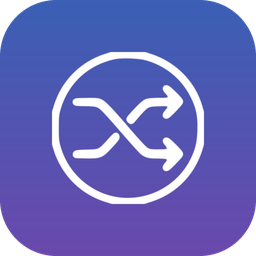
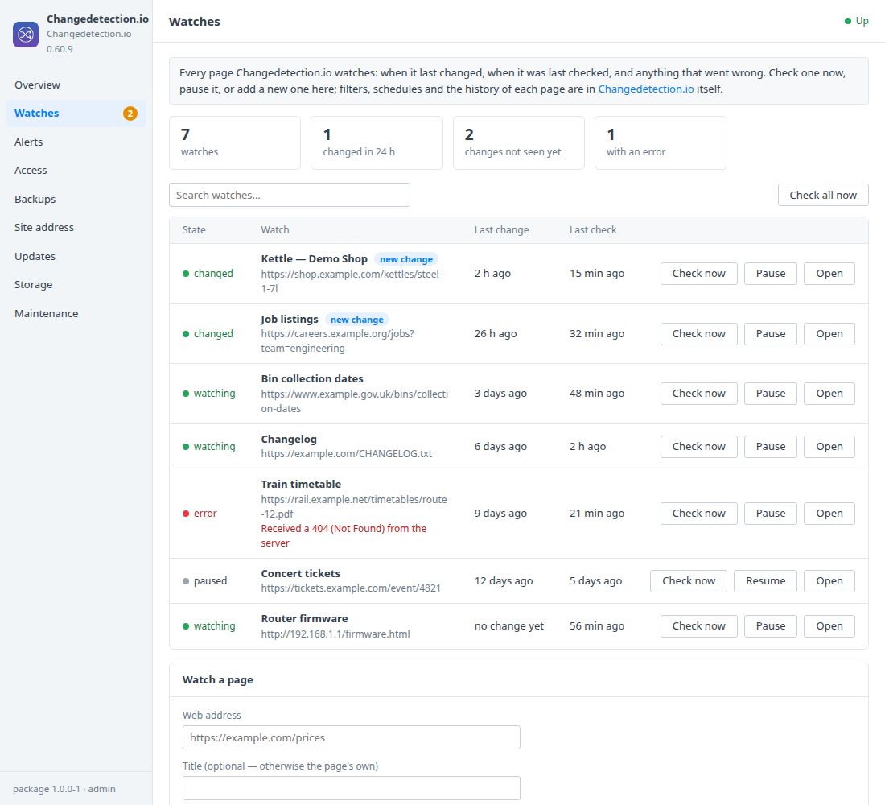
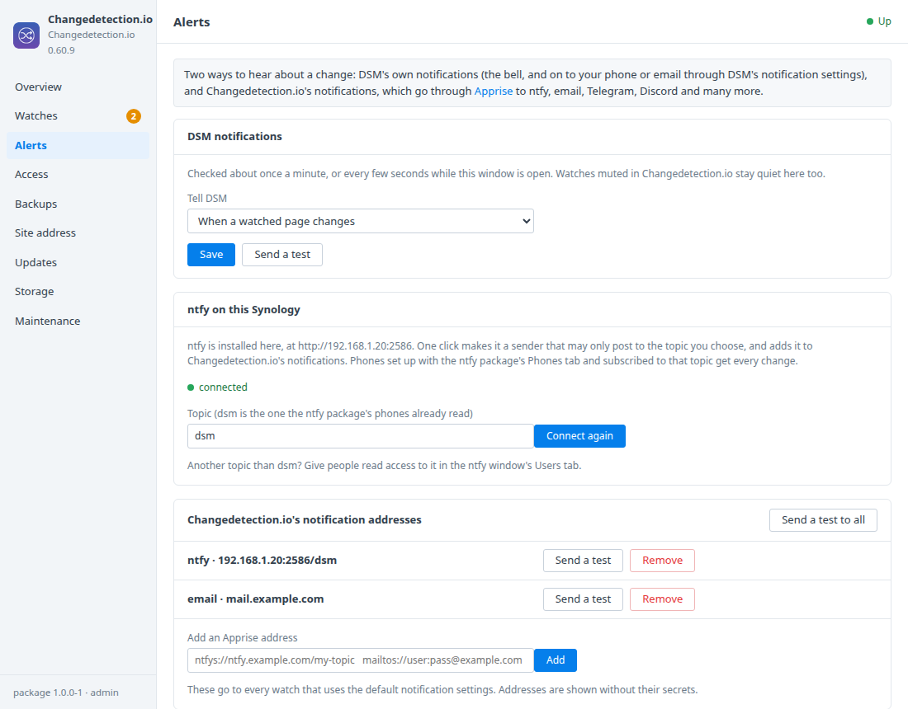
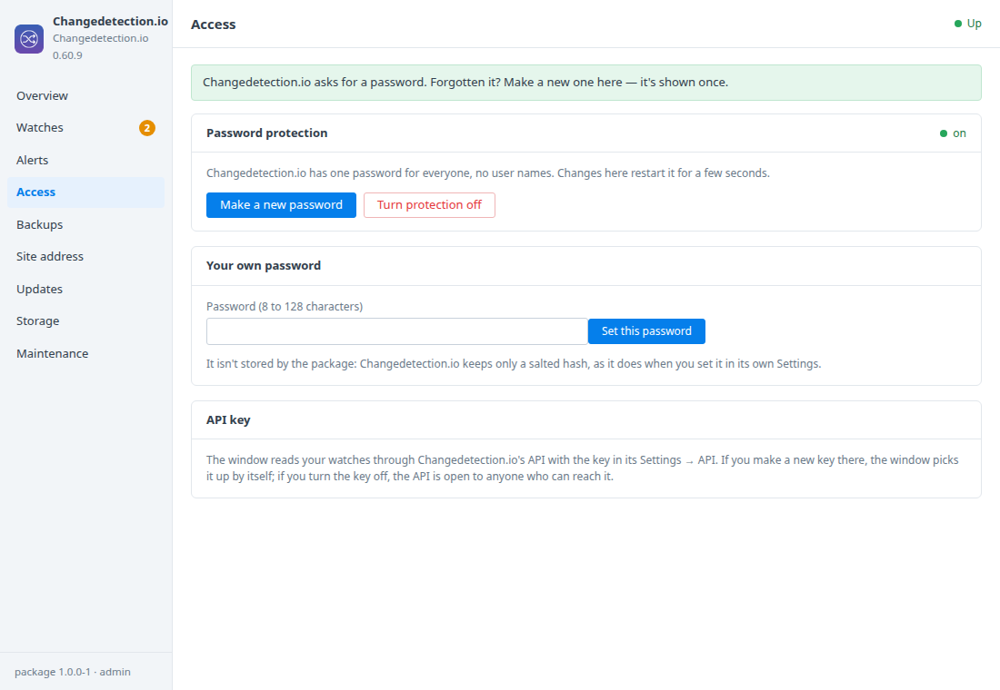
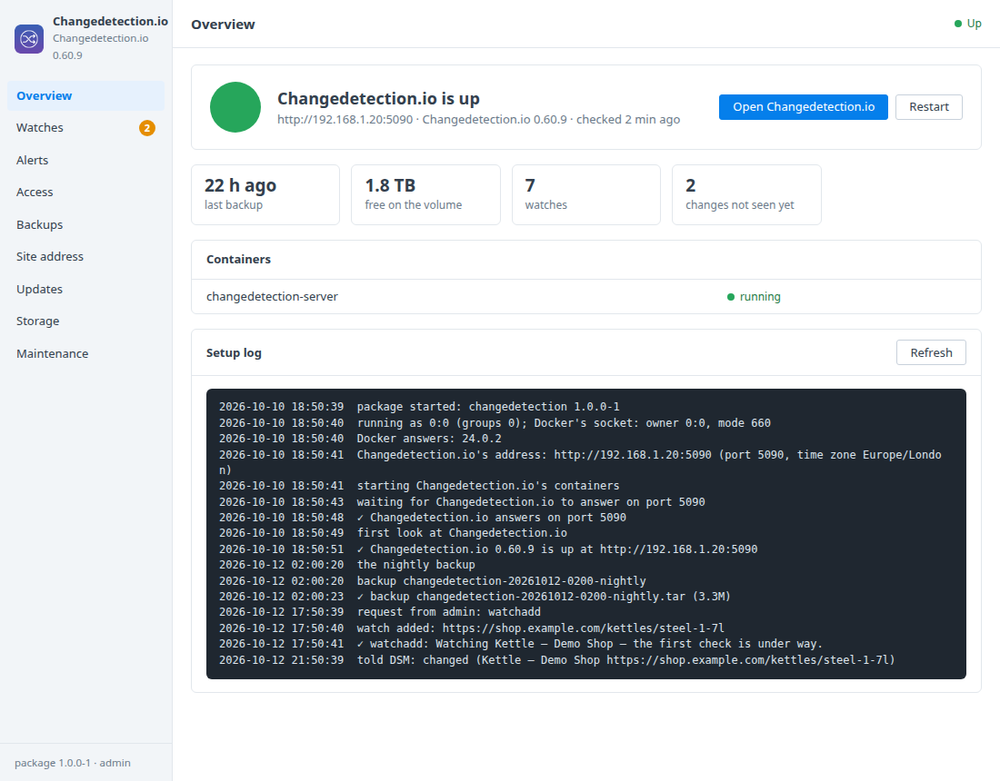

# Changedetection.io for Synology DSM

A DSM 7 package that installs [Changedetection.io](https://github.com/dgtlmoon/changedetection.io)
— the self-hosted website change monitor — in Container Manager, and adds a
**Changedetection.io** window to DSM: your watches with their last change,
last check and errors, DSM notifications and ntfy alerts when a page changes,
password protection, an optional browser for JavaScript-heavy pages, backups
and updates. Built on the [DSM app chassis](https://github.com/tombruton87/dsm-app-chassis).

## Download

### **[⬇ Download changedetection.spk](https://github.com/tombruton87/changedetection-dsm/releases/latest/download/changedetection.spk)**

[](https://github.com/tombruton87/changedetection-dsm/releases/latest)

That link always gives the newest version. Older ones are on the
[Releases](https://github.com/tombruton87/changedetection-dsm/releases) page.

Install: Package Center → Manual Install → the `.spk` (DSM 7.2.1+; Container
Manager is installed first if missing). The wizard asks for the NAS's address,
a port, a time zone, whether to ask for a password and whether to run the
browser. With protection on, the package makes a strong password at the first
start and shows it once in the window — there's no password to type in the
wizard.

## What the DSM window adds

- **Watches** — every watched page: when it last changed (and whether you've
  seen that change yet), when it was last checked, and the error if a check
  failed; with search. Add a page by its address (checked straight away),
  check one or all now, pause and resume, and jump to the change in
  Changedetection.io. Unseen changes show as a badge on the tab.
- **Pages on your own network** — Changedetection.io refuses addresses like
  192.168.… unless allowed; one switch allows them, for router and printer
  pages or other apps on the NAS.
- **Browser for JavaScript pages** — upstream's Chrome container
  (sockpuppetbrowser), off by default to save memory; turn it on and pick it
  when adding a watch.
- **Alerts** — DSM's own notifications when a watched page changes (and, if
  you like, when one can't be checked), with a test. If the
  [ntfy package](https://github.com/tombruton87/ntfy-dsm) runs on the same NAS,
  one click connects it: a sender that may only post to the topic you choose
  (`dsm` by default, which the ntfy package's phones already read), its token,
  and the address in Changedetection.io's notifications. Any other
  [Apprise](https://github.com/caronc/apprise/wiki) address (email, Telegram,
  Discord, …) can be added, tested and removed; addresses are shown without
  their secrets.
- **Access** — password protection on or off, a new password (shown once),
  or your own.
- **Backups, updates, storage, maintenance** — every watch with its history
  of snapshots in one file, nightly or now, with restore; Changedetection.io
  is pinned to a tested release, and the Updates tab moves it on when a newer
  one is out; a redacted support report, the logs, and Remove
  Changedetection.io and everything.

Administrators can do everything; a DSM user the app is granted to gets a
read-only window.

## Screenshots

| | |
|---|---|
|  |  |
|  |  |

## How it works

Changedetection.io runs as one container (`ghcr.io/dgtlmoon/changedetection.io`,
pinned) with its watches, snapshots and settings in the
`changedetection_data` volume; the browser is a second container in a compose
profile, started only when it's on. The window's watch list and every change
to watches and notification addresses go through Changedetection.io's own
API, with the API key it keeps in its settings — the package never stores a
copy. The password is the one setting the API can't change: the package
writes it into Changedetection.io's settings with the app stopped, hashed the
way Changedetection.io hashes it. DSM notifications come from comparing each
watch's last change with the last look, about once a minute.

## Layout

```
chassis/          the DSM app chassis (git submodule)
package.conf      name, title, service, volume, image, port, texts
app/compose.yaml  Changedetection.io; the optional browser; data in the changedetection_data volume
setup/app.sh      the hooks: first start, API, DSM notifications, ntfy, password, browser, updates
ui/               Watches, Alerts and Access tabs; CGI validation of their actions
wizard/           the Changedetection.io page of the install wizard
tests/            CGI checks and steps for the chassis harness
```

Test: `chassis/tests/test-api.sh <built target/ui> .`, and
`chassis/tests/e2e.sh . up && chassis/tests/e2e.sh . act` on any Linux box
with Docker (the steps start a test page to change and a stand-in ntfy).

Release: bump `VERSION`, add the changes to `CHANGELOG.md`, build, then attach
the package twice, under its versioned name and as `changedetection.spk` (the
download link above points at that name on the latest release):

```bash
cp dist/changedetection-X.Y.Z-1.spk /tmp/changedetection.spk
gh release create vX.Y.Z dist/changedetection-X.Y.Z-1.spk /tmp/changedetection.spk
```

Build: `chassis/build.sh . N`.

## Credits

The icon is Changedetection.io's own mark on a DSM-style tile in its blue and
violet. Changedetection.io is Apache-2.0 software by dgtlmoon;
this package is not affiliated with Changedetection.io or Synology.
